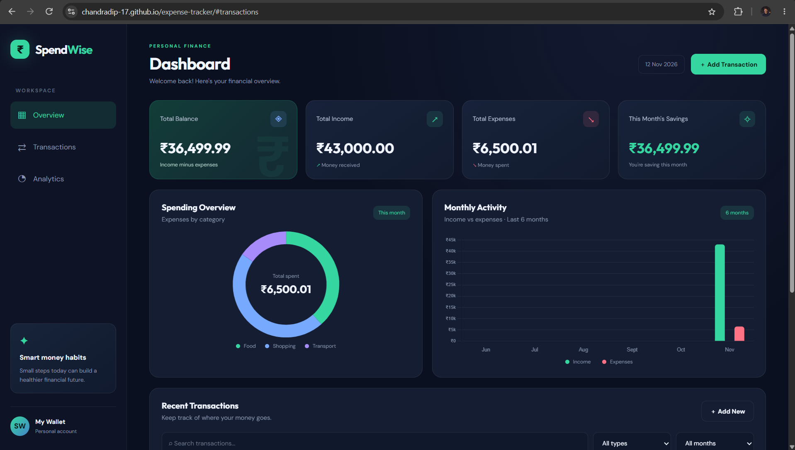
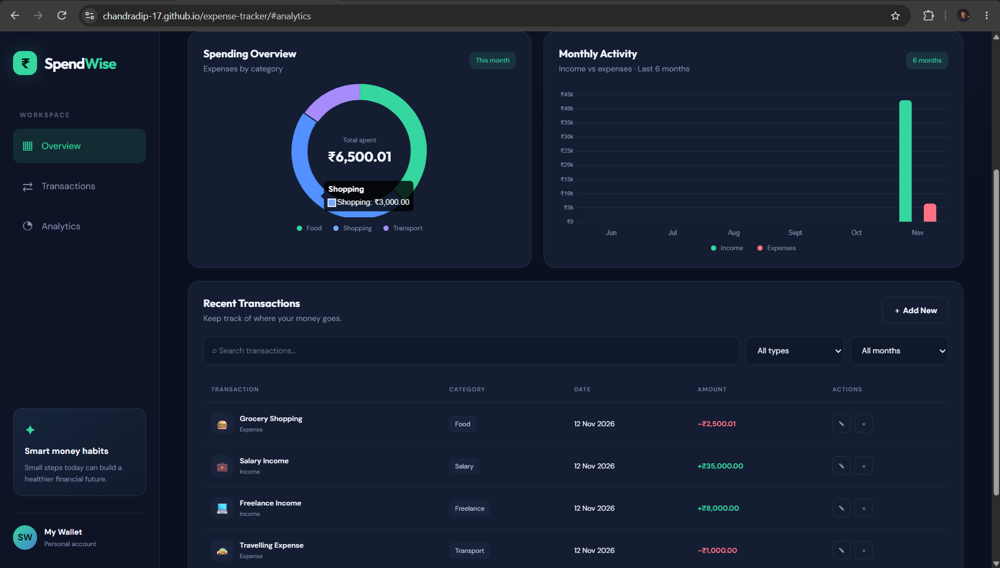
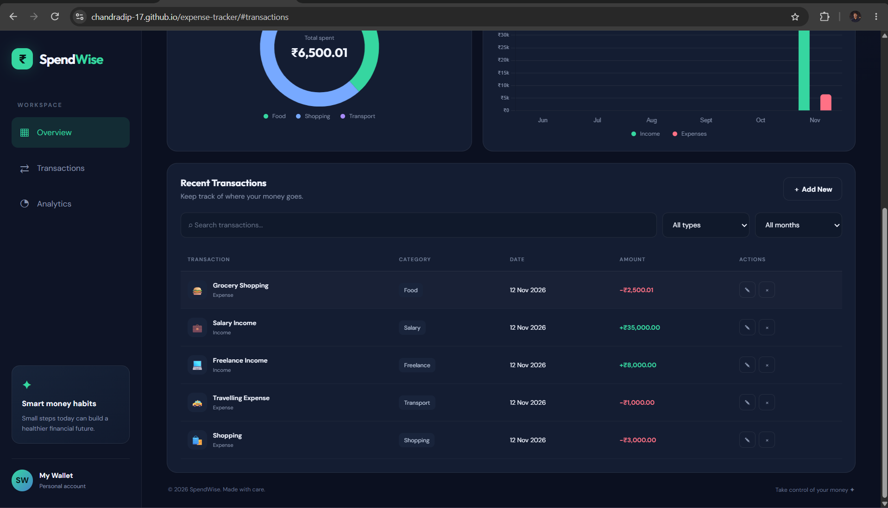

# 💰 SpendWise — Expense Tracker

<p align="center">
  <strong>A modern, dark-themed personal finance dashboard to track income, manage expenses, and monitor your savings.</strong>
</p>

<p align="center">
  
  
  
  
</p>

---

## 📌 About The Project

**SpendWise** is a modern and responsive expense tracker designed to make personal finance management simple and organized.

It helps users record their income and expenses, monitor their total balance, analyze spending habits through interactive charts, and keep track of their monthly savings.

The application features a sleek dark interface with a clean dashboard, smooth animations, and Indian Rupee (₹) currency formatting.

## ✨ Features

- 💰 **Dashboard Overview** — View total balance, income, expenses, and monthly savings.
- ➕ **Add Transactions** — Record income and expenses easily.
- ✏️ **Edit Transactions** — Update existing transaction details.
- 🗑️ **Delete Transactions** — Remove transactions when needed.
- 📊 **Category-wise Expense Chart** — Visualize spending by category.
- 📈 **Monthly Analytics** — Compare income and expenses over six months.
- 🔍 **Search Transactions** — Find transactions by description or category.
- 🗓️ **Month Filtering** — Filter transactions by month.
- 💾 **Local Storage** — Keep transaction data saved in your browser.
- 🇮🇳 **INR Currency** — Display financial amounts in Indian Rupees.
- 🌙 **Dark Theme** — Modern dark dashboard design.
- 📱 **Responsive Layout** — Designed for desktop, tablet, and mobile screens.

## 🖥️ Screenshots

### 🏠 Top Page


### 📊 Middle Page


### 💳 Lower Page


## 🛠️ Technologies Used

| Technology | Purpose |
|---|---|
| HTML5 | Website structure |
| CSS3 | Styling, animations, and responsive design |
| JavaScript | Application functionality and calculations |
| Chart.js | Interactive financial charts |
| Local Storage | Saving transaction data in the browser |
| Google Fonts | DM Sans and Outfit typography |

## 📂 Project Structure

```text
spendwise-expense-tracker/
│
├── index.html
├── style.css
├── script.js
├── README.md
├── LICENSE
│
└── screenshots/
    ├── top-page.png
    ├── mid-page.png
    └── lower-page.png
```

## 🚀 Getting Started

Follow these steps to run SpendWise on your computer.

### 1. Clone the Repository

```bash
git clone YOUR_GITHUB_REPOSITORY_URL
```

### 2. Open the Project

```bash
cd spendwise-expense-tracker
```

Open the folder in Visual Studio Code.

### 3. Run the Application

- Open `index.html` in VS Code.
- Right-click inside the editor.
- Select **Open with Live Server**.
- SpendWise will open in your browser.

### 4. Start Tracking

Add your income and expenses, explore the dashboard, and monitor your financial activity.

## 💾 Data Storage

SpendWise uses the browser's **Local Storage** to save transactions.

- Your transactions remain available after refreshing the page in the same browser.
- Data is stored locally on your device.
- Transactions are not automatically synchronized between different devices or browsers.
- Clearing browser storage can delete saved transactions.

## 📊 Charts

SpendWise uses [Chart.js](https://www.chartjs.org/) to display:

- Category-wise monthly expenses.
- Six-month income and expense comparisons.

An internet connection is required to load the Chart.js library and Google Fonts from their external sources.

## 🔮 Future Improvements

- [ ] Export transactions to CSV or PDF.
- [ ] Monthly budget planning.
- [ ] Savings goals.
- [ ] Expense reports and analytics.
- [ ] Custom date-range filtering.
- [ ] Transaction backup and restore.
- [ ] Cloud synchronization.
- [ ] Multi-currency support.

## 🔐 License

This project is distributed under the **MIT License**. See the [LICENSE](./LICENSE) file for details.

## 👨‍💻 Author

**Your Name**

If you found this project useful, consider giving it a ⭐ on GitHub!

---

<p align="center">
  Made with ❤️ using HTML, CSS and JavaScript.
</p>